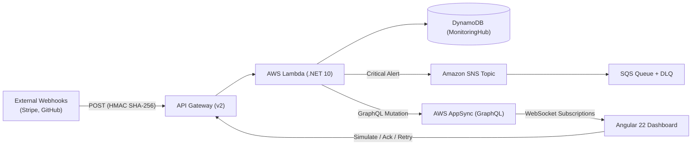

# Alert Pulse ⚡

> **Real-Time Webhook Ingestion, Anomaly Detection & Incident Operations Hub**  
> Built with **.NET 10 Minimal APIs**, **Angular 22 (Signals & Standalone)**, **AWS Serverless**, and **AWS AppSync GraphQL WebSockets**.

[](https://github.com/biel-correa/alert-pulse/actions/workflows/frontend-ci.yml)
[](https://github.com/biel-correa/alert-pulse/actions/workflows/backend-ci.yml)
[](LICENSE)

---

## 📖 Architecture & Technical Documentation

For in-depth architectural specifications and diagrams, see the dedicated guides inside the Obsidian vault:

- 🏗️ **[Application Architecture & Workflow (`alert-pulse-vault/APPLICATION_ARCHITECTURE.md`)](file:///Users/gcorrea/Documents/projetos/alert-pulse/alert-pulse-vault/APPLICATION_ARCHITECTURE.md)**  
  Detailed breakdown of the .NET 10 ingestion pipeline, HMAC SHA-256 verification, dynamic severity classification, DynamoDB single-table schema, and Angular 22 Signals reactivity.
- ☁️ **[AWS Cloud Architecture Blueprint (`alert-pulse-vault/AWS_ARCHITECTURE.md`)](file:///Users/gcorrea/Documents/projetos/alert-pulse/alert-pulse-vault/AWS_ARCHITECTURE.md)**  
  Complete cloud topology covering CloudFront, S3, API Gateway v2, Lambda, ECR, DynamoDB, SNS, SQS, AppSync GraphQL, IAM least privilege roles, and live AWS resource inventories.
- 🧠 **[Alert Pulse Obsidian Vault (`alert-pulse-vault/`)](file:///Users/gcorrea/Documents/projetos/alert-pulse/alert-pulse-vault/)**  
  Interactive system design canvas, data access patterns, and operational runbooks.

---

## 🎯 What is Alert Pulse?

In modern microservices, external third-party webhooks (e.g. Stripe, GitHub, Shopify, Twilio) frequently fail silently or trigger cascading outages when upstream APIs experience latency spikes or schema drift. 

**Alert Pulse** provides:
- **Sub-100ms Ingestion**: Minimal API endpoint with non-blocking async execution.
- **Cryptographic Security**: HMAC SHA-256 validation (`X-Hub-Signature-256`) with constant-time equality comparisons.
- **Dynamic Classification**: Automatic categorization into `INFO`, `WARNING`, and `CRITICAL` based on status code and response latency.
- **Zero-Polling Real-Time Feed**: Live WebSocket push to the Angular dashboard via AWS AppSync GraphQL subscriptions.
- **Decoupled Incident Alerting**: Asynchronous SNS fan-out to SQS queues and on-call alerting channels.
- **Single-Table NoSQL Persistence**: DynamoDB with automated 30-day Time to Live (TTL) zero-cost cleanup.
- **SRE Remediation Tools**: Single-click incident acknowledgment, payload inspection, retry replays, and chaotic incident simulations.

---

## 🏛️ System Overview



---

## 🗂️ Monorepo Structure

```text
alert-pulse/
├── .github/
│   └── workflows/
│       ├── backend-ci.yml         # .NET 10 build, xUnit test, Docker buildx & ECR push
│       └── frontend-ci.yml        # Angular build, Karma headless test, S3 sync & CloudFront invalidation
├── alert-pulse-vault/             # Obsidian architecture documentation & Canvas maps
│   ├── APPLICATION_ARCHITECTURE.md# Complete application architecture & mechanics
│   ├── AWS_ARCHITECTURE.md        # Comprehensive AWS cloud infrastructure guide
│   ├── Architecture/              # System design & event-driven patterns
│   └── Infrastructure/            # AWS console & LocalStack guides
├── backend/                       # .NET 10 Minimal API Webhook Dispatcher
│   ├── src/WebhookMonitor/        # Ingestion, HMAC, Classification, DynamoDB & AppSync services
│   ├── tests/WebhookMonitor.Tests/# xUnit unit and integration test suite
│   ├── Dockerfile                 # Multi-stage production container build
│   └── WebhookMonitor.slnx        # Solution configuration
├── frontend/                      # Angular 22 Single Page Application
│   ├── src/app/
│   │   ├── core/                  # AppSync WebSocket service, models & state management
│   │   └── features/dashboard/    # Reactive operations telemetry dashboard
│   ├── Dockerfile                 # Nginx-based production SPA container
│   └── package.json
├── infra/                         # Infrastructure-as-Code & deployment scripts
│   ├── appsync/                   # AppSync schema & VTL request/response resolvers
│   └── init-aws.sh                # LocalStack initialization script
├── docker-compose.yml             # Full local emulation (LocalStack, DynamoDB Admin, Mailpit, API, SPA)
└── README.md
```

---

## 🚀 Quick Start (Local Development)

### Prerequisites
- [Docker](https://www.docker.com/) & Docker Compose
- [.NET 10 SDK](https://dotnet.microsoft.com/)
- [Node.js 22+](https://nodejs.org/) & npm
- [AWS CLI](https://aws.amazon.com/cli/) *(optional for cloud operations)*

---

### Option 1: Run Full Stack via Docker Compose

Launch the entire ecosystem with local cloud emulation (DynamoDB, SNS, SQS via LocalStack):

```bash
docker compose up -d --build
```

#### Local Endpoints:
- 📊 **Angular Dashboard:** [http://localhost:4200](http://localhost:4200)
- ⚙️ **Backend Web API & Swagger:** [http://localhost:5050/swagger](http://localhost:5050/swagger)
- 🗄️ **DynamoDB Admin GUI:** [http://localhost:8001](http://localhost:8001)
- 📬 **Mailpit (SNS Email Preview):** [http://localhost:8025](http://localhost:8025)
- 📡 **Webhook Replay Sink:** [http://localhost:8080](http://localhost:8080)

---

### Option 2: Run Services Individually

#### 1. Start Local Infrastructure Dependencies
```bash
docker compose up -d localstack dynamodb-admin mailpit webhook-sink
```

#### 2. Run Backend (.NET 10)
```bash
cd backend/src/WebhookMonitor
dotnet run
```
The API starts on `http://localhost:5000`.

#### 3. Run Frontend (Angular 22)
```bash
cd frontend
npm install
npm start
```
The dashboard starts on `http://localhost:4200`.

---

## 🧪 Testing

### Backend Unit & Integration Tests
```bash
dotnet test backend/WebhookMonitor.slnx --verbosity normal
```

### Frontend Karma Headless Tests
```bash
cd frontend
npm test -- --watch=false --browsers=ChromeHeadless
```

---

## 📡 Simulating Webhooks & Incidents

### Ingest a Healthy Webhook
```bash
curl -X POST "http://localhost:5050/api/v1/webhooks/ingest/stripe-billing" \
  -H "Content-Type: application/json" \
  -H "X-Hub-Signature-256: sha256=..." \
  -d '{"event": "payment_intent.succeeded", "amount": 9900}'
```

### Trigger a Chaos Incident Drill
```bash
curl -X POST "http://localhost:5050/webhooks/simulate" \
  -H "Content-Type: application/json" \
  -d '{"endpointId": "stripe-billing", "failureType": "CRITICAL"}'
```
Watch the incident turn **red** in real time on the Angular dashboard via WebSockets!

---

## ☁️ Production Deployment (AWS)

Alert Pulse is fully deployed to AWS in `us-east-1`:

| Service | Component | Live Resource ID / Domain |
| :--- | :--- | :--- |
| **Frontend CDN** | Amazon CloudFront | [`d2n2j5koz3gyln.cloudfront.net`](https://d2n2j5koz3gyln.cloudfront.net) |
| **Frontend Storage**| Amazon S3 | `alert-pulse-dashboard` |
| **Backend API** | Amazon API Gateway (v2) | `https://org7umv1uc.execute-api.us-east-1.amazonaws.com` |
| **Compute** | AWS Lambda | `AlertPulseBackendApi` (.NET 10 ARM64) |
| **Container Registry**| Amazon ECR | `010119842118.dkr.ecr.us-east-1.amazonaws.com/alert-pulse-api` |
| **Realtime Pub/Sub**| AWS AppSync GraphQL | `AlertPulsePublicApi` (`ar4sggjfjrhypih7baemmtu2j4`) |
| **NoSQL Database**| Amazon DynamoDB | `MonitoringHub` (On-Demand, GSI1, TTL) |
| **Alerting Topic**| Amazon SNS | `WebhookCriticalAlerts` |
| **Alert Queues** | Amazon SQS | `critical-alerts-queue` & `critical-alerts-dlq` |

All cloud resources are automatically managed, continuously verified, and tagged with `Project = "Alert Pulse"`.

---

## 📄 License

This project is licensed under the MIT License. See [LICENSE](LICENSE) for details.
