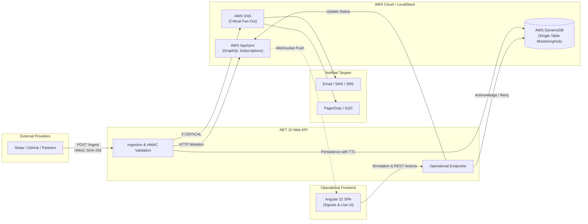

# Alert Pulse: Webhook Dispatcher & Incident Monitor

> **Event monitoring hub and webhook ingestion platform with asynchronous processing, NoSQL persistence, and real-time reactive UI.**

Alert Pulse is a distributed platform architected as a **Monorepo**, unifying backend (.NET 10), frontend (Angular 22), Infrastructure (LocalStack & Docker Compose), and technical documentation under a single Git repository. Designed for high availability and low latency, it ingests webhooks from external providers (such as Stripe, GitHub, payment gateways, and partners), verifies cryptographic authenticity (HMAC SHA-256), classifies incident severity, persists event history in DynamoDB (*Single-Table Design*), dispatches critical notifications via AWS SNS, and pushes live updates via AWS AppSync (GraphQL Subscriptions over WebSockets) to an operational Angular dashboard.

> [!NOTE] Monorepo Structure
> The repository centralizes all development tracks: `backend/` (.NET 10 Web API), `frontend/` (Angular SPA), `infra/` (AWS AppSync & LocalStack), and `alert-pulse-vault/` (this Obsidian vault). Refer to [[Monorepo-Structure|Monorepo Structure & Strategy]] for organization details and root orchestration commands.

---

## 🗺️ Map of Content (MOC)

Explore project documentation organized by domain:

```
docs/
├── 00 - Home.md (You are here)
├── [[Roadmap|Engineering Development Roadmap]]
├── Architecture/
│   ├── [[Overview|Architecture Overview]]
│   ├── [[Monorepo-Structure|Monorepo Structure & Strategy]]
│   ├── [[System-Flow|System Flows & Lifecycles]]
│   └── [[Event-Driven-Design|Event-Driven Patterns (SNS & AppSync)]]
├── Data/
│   ├── [[DynamoDB-Design|NoSQL Data Modeling (Single-Table Design)]]
│   └── [[Access-Patterns|Access Patterns & Secondary Indexes]]
├── GraphQL/
│   ├── [[Schema|GraphQL Schema (AppSync)]]
│   └── [[Resolvers-and-Realtime|Resolvers & Real-Time WebSockets]]
├── Backend/
│   ├── [[DotNet-Architecture|.NET 10 Web API Architecture]]
│   ├── [[Webhook-Ingestion|Ingestion Pipeline & HMAC Validation]]
│   ├── [[Operational-Endpoints|REST Endpoints Catalog]]
│   └── [[Service-Implementations|C# Service Implementations]]
├── Frontend/
│   ├── [[Angular-Architecture|Angular 22 Architecture & Signals]]
│   ├── [[Monitoring-Service|Telemetry & State Service]]
│   ├── [[Realtime-Subscriptions|WebSocket Subscriptions (AppSync)]]
│   └── [[Dashboard-Component|Operational Dashboard Component]]
├── Infrastructure/
│   ├── [[AWS-Console|AWS Console Setup & Resource Runbook]]
│   ├── [[AWS-Setup|AWS Setup (CLI & IAM Policies)]]
│   └── [[LocalStack-Docker|Local Environment with Docker & LocalStack]]
├── Runbooks/
│   ├── [[Local-Development|Local Development Guide]]
│   ├── [[Incident-Response|Incident Response Procedures]]
│   └── [[Testing-Strategy|Testing Strategy (Unit to E2E)]]
└── Templates/
    └── [[Incident-Postmortem|Incident Post-Mortem Template]]
```

---

## 🏗️ High-Level System Architecture



---

## ⚡ Technology Stack

| Component | Technology | Role in System |
| :--- | :--- | :--- |
| **Backend API** | .NET 10 (C#) Minimal APIs | High-throughput ingestion, HMAC verification, SNS dispatcher, and AppSync mutations. |
| **Database** | AWS DynamoDB | NoSQL persistence with *Single-Table Design*, GSI for open incidents, and 30-day automatic TTL. |
| **Async Messaging** | AWS SNS | *Fan-out* notification bus with *Filter Policies* for `CRITICAL` alerts via Email, SMS, or SQS queues. |
| **Real-Time Layer** | AWS AppSync | Managed GraphQL API providing historical queries and WebSocket subscriptions. |
| **Operational Frontend** | Angular 22 | SPA using *Signals*, standalone components, WebSocket streaming, and immediate mitigation actions (*Ack/Retry*). |
| **Cloud Provisioning** | AWS Console / AWS CLI | Interactive and scriptable cloud infrastructure provisioning. |
| **Local Environment** | Docker / LocalStack | Full emulation of DynamoDB, SNS, and SQS on port `4566` without cloud costs. |
| **Local DX Tooling** | DynamoDB Admin / Mailpit / Webhook Sink | Local UIs for NoSQL inspection (`:8001`), alert email preview (`:8025`), and retry mocking (`:8080`). |

---

## 🚀 Getting Started

1. To understand the architectural design and core decisions, read [[Overview|Architecture Overview]].
2. For repository layout and workspace orchestration, refer to [[Monorepo-Structure|Monorepo Structure & Strategy]].
3. To spin up the local environment with zero cloud costs, follow the [[Local-Development|Local Development Guide]].
4. To learn how data is stored and retrieved, review [[DynamoDB-Design|DynamoDB Data Modeling]] and [[Access-Patterns|Access Patterns]].
5. To inspect API signatures, check [[Operational-Endpoints|REST Endpoints Catalog]] and [[Schema|GraphQL Schema]].
6. In case of production alerts, consult the [[Incident-Response|Incident Response Runbook]].
