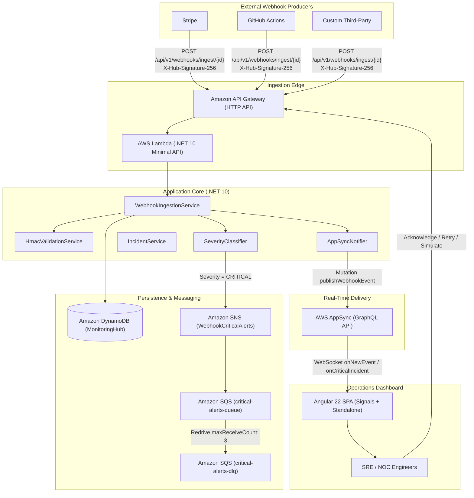
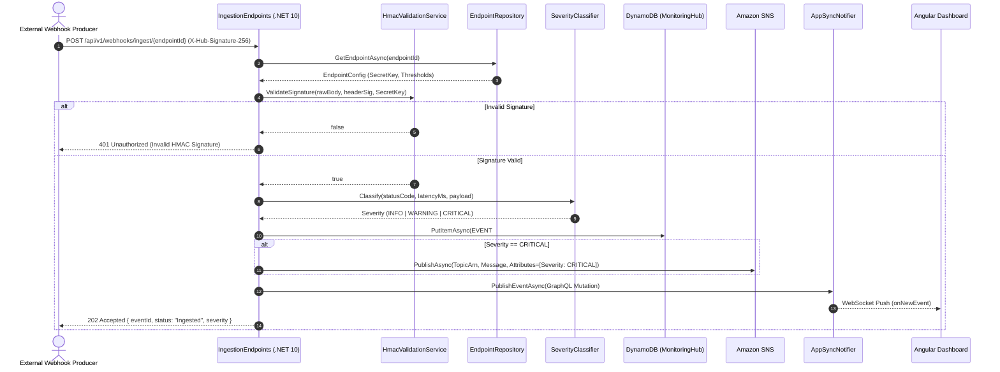
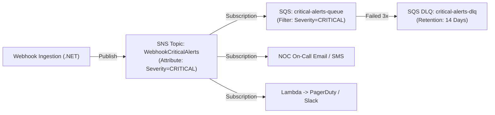

# Alert Pulse: Application Architecture & Internal Mechanics

> **Version:** 1.0.0  
> **Target Framework:** .NET 10 (C# 14) & Angular 22  
> **Architecture Pattern:** Event-Driven Serverless / Modular Monorepo  

---

## 1. Executive Summary & Core Mission

**Alert Pulse** is a high-throughput webhook ingestion, anomaly detection, and operational monitoring platform. In modern distributed systems, third-party webhooks (e.g., Stripe payments, GitHub deployments, Shopify events, Twilio messages) frequently fail silently due to payload corruption, latency spikes, or upstream service outages. 

Alert Pulse solves this by:
1. **Validating & Ingesting** external webhooks with cryptographic HMAC SHA-256 signature verification in `< 100ms`.
2. **Classifying Anomalies** dynamically by response code, latency threshold, and payload errors into `INFO`, `WARNING`, and `CRITICAL` severity levels.
3. **Persisting Telemetry** using DynamoDB single-table design with automated 30-day retention via native Time to Live (TTL).
4. **Decoupling Alert Dispatch** through an AWS SNS fan-out pattern to SQS dead-letter queues and incident responders.
5. **Broadcasting Real-Time Telemetry** directly to an Angular 22 Operations Dashboard over AWS AppSync GraphQL WebSockets—with **zero polling**.
6. **Enabling Remediation** with one-click incident acknowledgement, payload inspection, and historical replay/retries.

---

## 2. High-Level System Architecture

The following diagram illustrates the end-to-end data flow from external producers to NOC / SRE operators:



---

## 3. Ingestion Engine & Backend Mechanics (.NET 10)

The backend is built as an ultra-lean .NET 10 Minimal API located in [`backend/src/WebhookMonitor/`](file:///Users/gcorrea/Documents/projetos/alert-pulse/backend/src/WebhookMonitor/). It supports dual hosting targets:
- **Serverless**: Running inside AWS Lambda via `Amazon.Lambda.AspNetCoreServer.Hosting`.
- **Containerized**: Running as a Docker container on AWS App Runner / ECS Fargate or local Docker Compose.

### 3.1 Webhook Ingestion Pipeline

When an external service posts to [`IngestionEndpoints`](file:///Users/gcorrea/Documents/projetos/alert-pulse/backend/src/WebhookMonitor/Endpoints/IngestionEndpoints.cs#L14):
`POST /api/v1/webhooks/ingest/{endpointId}`

The execution pipeline follows these synchronous and asynchronous phases:



### 3.2 Security & Cryptographic HMAC Verification

To guarantee origin authenticity and prevent spoofing attacks:
- The caller sends a SHA-256 HMAC hash in the `X-Hub-Signature-256` header (standardized by Stripe, GitHub, Shopify).
- [`HmacValidationService`](file:///Users/gcorrea/Documents/projetos/alert-pulse/backend/src/WebhookMonitor/Services/HmacValidationService.cs) computes `HMACSHA256` over the raw request payload using the endpoint's pre-shared secret.
- **Constant-Time Comparison:** Hashes are evaluated using `CryptographicOperations.FixedTimeEquals` to prevent side-channel timing attacks that could reveal secret bytes.

### 3.3 Dynamic Severity Classification

The [`SeverityClassifier`](file:///Users/gcorrea/Documents/projetos/alert-pulse/backend/src/WebhookMonitor/Services/SeverityClassifier.cs) categorizes incoming events according to response performance and HTTP status code:

| Severity | Criteria | Triggered Actions |
| :--- | :--- | :--- |
| **`INFO`** | HTTP 200–299 and Latency < 1000ms | Persisted to DynamoDB, broadcasted to Dashboard live feed. |
| **`WARNING`** | HTTP 400–499 or Latency between 1000ms–3000ms | Flagged on dashboard, highlighted in incident metrics. |
| **`CRITICAL`** | HTTP 500–599, Latency > 3000ms, or Unhandled Exception | Persisted as `CRITICAL#OPEN`, triggers SNS Alert Topic Fan-Out, highlighted in red on NOC UI. |

### 3.4 Operational & Remediation Endpoints

The backend exposes operational routes in [`OperationalEndpoints`](file:///Users/gcorrea/Documents/projetos/alert-pulse/backend/src/WebhookMonitor/Endpoints/OperationalEndpoints.cs) for administrative workflows:

1. **Simulate Webhook / Incident:**
   `POST /webhooks/simulate`  
   Generates synthetic anomalies (`CRITICAL`, `WARNING`, `LATENCY_SPIKE`) for live chaos testing and incident drill verification.
2. **Acknowledge Incident:**
   `POST /api/v1/incidents/{endpointId}/{eventId}/ack`  
   Updates the DynamoDB record status to `ACKNOWLEDGED` by setting `SeverityStatus = CRITICAL#ACKNOWLEDGED`, stopping escalations.
3. **Retry Webhook Payload:**
   `POST /api/v1/incidents/{endpointId}/{eventId}/retry`  
   Re-fetches the original raw payload from DynamoDB and re-dispatches it to the designated webhook target endpoint, recording the retry timestamp and result.

---

## 4. NoSQL Data Architecture (Amazon DynamoDB)

Alert Pulse adopts **Single-Table Design** on Amazon DynamoDB using the table `MonitoringHub`.

### 4.1 Schema Definition

| Attribute | Data Type | Description |
| :--- | :--- | :--- |
| **`PK`** | String (Hash) | Partition Key: Entity partition identifier. |
| **`SK`** | String (Range) | Sort Key: Item identifier or hierarchical path. |
| **`SeverityStatus`** | String | Composite attribute (e.g. `CRITICAL#OPEN`, `CRITICAL#ACK`) for GSI1. |
| **`CreatedAt`** | String (ISO 8601) | Timestamp of event receipt. |
| **`ExpiresAt`** | Number (Epoch) | DynamoDB TTL attribute: Expiration timestamp (30 days from creation). |
| **`Payload`** | String / JSON | Raw payload body. |
| **`LatencyMs`** | Number | Round-trip processing latency in milliseconds. |
| **`StatusCode`** | Number | Upstream or simulated HTTP response status. |

### 4.2 Entity Partition Layout

```
Table: MonitoringHub
=========================================================================================================================
PK                         | SK                   | SeverityStatus        | CreatedAt            | ExpiresAt (TTL)
=========================================================================================================================
ENDPOINT#stripe-billing    | METADATA             | -                     | 2026-10-11T10:00:00Z | -
ENDPOINT#stripe-billing    | EVENT#evt_01J9X4...  | CRITICAL#OPEN         | 2026-10-11T12:00:00Z | 1794326400 (+30d)
ENDPOINT#github-actions    | EVENT#evt_01J9X5...  | INFO#RESOLVED         | 2026-10-11T12:05:00Z | 1794326700 (+30d)
```

### 4.3 Global Secondary Index (GSI1-Severity)

- **Index Name:** `GSI1-Severity`
- **Partition Key:** `SeverityStatus`
- **Sort Key:** `CreatedAt`
- **Purpose:** Enables instant queries for active incidents (e.g. `Query(SeverityStatus = "CRITICAL#OPEN")`) sorted chronologically without performing expensive table scans.

### 4.4 Automated Zero-Cost Retention (TTL)

The `ExpiresAt` field stores the Unix epoch seconds timestamp representing `DateTimeOffset.UtcNow.AddDays(30).ToUnixTimeSeconds()`. DynamoDB's background TTL sweeper deletes expired records automatically with **zero consumed read or write capacity units**.

---

## 5. Asynchronous Messaging & Alerting (Amazon SNS & SQS)

To isolate ingestion performance from notification delays, critical incidents are processed via an asynchronous **Fan-Out** pattern:



- **Subscription Filter Policy:** Downstream subscribers filter messages at the SNS layer (`{"Severity": ["CRITICAL"]}`), discarding non-critical events before they hit worker queues.
- **Dead-Letter Queue (DLQ):** The main SQS queue configures a `RedrivePolicy` with `maxReceiveCount: 3`. If downstream alert processors fail to process an alert 3 times, the message moves to `critical-alerts-dlq` to prevent poison message loops.

---

## 6. Real-Time Telemetry via AWS AppSync (GraphQL)

Rather than having dashboard clients poll the backend every 2–5 seconds, Alert Pulse uses **AWS AppSync GraphQL Subscriptions over WebSockets**.

### 6.1 GraphQL Schema

```graphql
type WebhookEvent {
  id: ID!
  endpointId: String!
  severity: String!
  statusCode: Int!
  latencyMs: Int!
  timestamp: String!
  message: String!
}

type Mutation {
  publishWebhookEvent(input: WebhookEventInput!): WebhookEvent!
    @aws_api_key
  updateEventStatus(eventId: ID!, status: String!): EventStatusResponse!
    @aws_api_key
}

type Subscription {
  onNewEvent(endpointId: String): WebhookEvent
    @aws_subscribe(mutations: ["publishWebhookEvent"])
  onCriticalIncident: WebhookEvent
    @aws_subscribe(mutations: ["publishWebhookEvent"])
}
```

### 6.2 AppSync Data Sources & Local Pub/Sub

1. **`NoneDataSource` (Local Passthrough):** Used for `Mutation.publishWebhookEvent`. Since DynamoDB persistence is already handled by .NET, AppSync acts purely as an event broadcaster. The VTL resolver immediately returns `$ctx.arguments.input`, broadcasting the payload to active WebSocket connections.
2. **`DynamoDBDataSource`:** Used for `Query.getOpenIncidents` and `Query.getRecentEvents`, querying the `MonitoringHub` table directly if the frontend refreshes or reloads historical data.

---

## 7. Frontend Operations Dashboard (Angular 22)

The frontend is an operational Single Page Application (SPA) located in [`frontend/`](file:///Users/gcorrea/Documents/projetos/alert-pulse/frontend/).

### 7.1 Key Frontend Technologies
- **Angular 22:** Standalone Components with modern Control Flow (`@if`, `@for`).
- **Reactive State via Angular Signals:** Fine-grained reactivity using `signal()`, `computed()`, and `effect()`.
- **WebSocket Streaming:** Custom [`AppSyncSubscriptionService`](file:///Users/gcorrea/Documents/projetos/alert-pulse/frontend/src/app/core/services/appsync-subscription.service.ts) managing the AWS AppSync Real-Time WebSocket handshake protocol.
- **Lucide Angular Icons:** Crisp telemetry visualizations.

### 7.2 WebSocket Real-Time Handshake

AWS AppSync requires a specialized base64-encoded authentication header inside the WebSocket connection query string:

```
wss://<api-id>.appsync-realtime-api.us-east-1.amazonaws.com/graphql?header=<base64-json>&payload=e30=
```

[`AppSyncSubscriptionService`](file:///Users/gcorrea/Documents/projetos/alert-pulse/frontend/src/app/core/services/appsync-subscription.service.ts):
1. Encodes the host and API key into standard Base64:
   ```json
   {
     "host": "<api-id>.appsync-api.us-east-1.amazonaws.com",
     "x-api-key": "da2-..."
   }
   ```
2. Sends the `connection_init` payload.
3. Upon receiving `connection_ack`, registers the GraphQL subscription:
   ```json
   {
     "id": "<sub-uuid>",
     "type": "start",
     "payload": {
       "data": "{\"query\":\"subscription OnNewEvent { onNewEvent { id endpointId severity statusCode latencyMs timestamp message } }\"}",
       "extensions": { "authorization": { "host": "...", "x-api-key": "..." } }
     }
   }
   ```
4. Emits incoming data events directly into Angular's `MonitoringService` Signals.

### 7.3 State Management & Signal Pipeline

[`MonitoringService`](file:///Users/gcorrea/Documents/projetos/alert-pulse/frontend/src/app/core/services/monitoring.service.ts) exposes reactive signals for the UI:

```typescript
// Signals
readonly events = signal<WebhookEvent[]>([]);
readonly connectionStatus = signal<'connected' | 'connecting' | 'disconnected'>('disconnected');

// Computed Derived Telemetry
readonly criticalCount = computed(() => 
  this.events().filter(e => e.severity === 'CRITICAL').length
);

readonly avgLatencyMs = computed(() => {
  const list = this.events();
  return list.length === 0 ? 0 : Math.round(list.reduce((acc, e) => acc + e.latencyMs, 0) / list.length);
});
```

When an event arrives, `this.events.update(prev => [newEvent, ...prev.slice(0, 49)])` pushes the record into the signal array, updating all cards, charts, and tables without manual change detection cycles.

---

## 8. Incident Simulation & Disaster Recovery

To allow testing and drills without waiting for production failures:
- **Simulation Button:** The dashboard provides a "Simulate Incident" button that invokes `POST /webhooks/simulate` on the backend API Gateway.
- **Error Types:** Generates payloads with 500 Internal Server Error, high latency (> 3500ms), or database connection timeout anomalies.
- **Drill Flow:** Operators can observe the incident turn red in real time, inspect the payload stack trace, click **Acknowledge**, and trigger **Retry** against mock webhook receivers.

---

## 9. Summary: Architectural Contracts & Data Flow

| Component | Protocol | Input Contract | Output Contract |
| :--- | :--- | :--- | :--- |
| **Ingestion API** | HTTPS / REST | Raw Body + `X-Hub-Signature-256` | `202 Accepted` + `EventId` |
| **Classification** | In-Process | Status Code + Latency (ms) | `INFO` \| `WARNING` \| `CRITICAL` |
| **DynamoDB** | AWS SDK (gRPC/HTTP) | PutItem (`PK`, `SK`, `SeverityStatus`, `ExpiresAt`) | Committed item |
| **SNS Dispatch** | AWS SDK (HTTPS) | Publish (`Message`, `Severity: CRITICAL`) | MessageId |
| **AppSync Mutation**| GraphQL / HTTP | `publishWebhookEvent(input: ...)` | Broadcast payload |
| **AppSync Realtime**| WebSocket (WSS) | `subscription { onNewEvent }` | Event stream |
| **Angular Dashboard**| WSS + REST | Realtime Stream + User Actions | Rendered UI + Signals |
