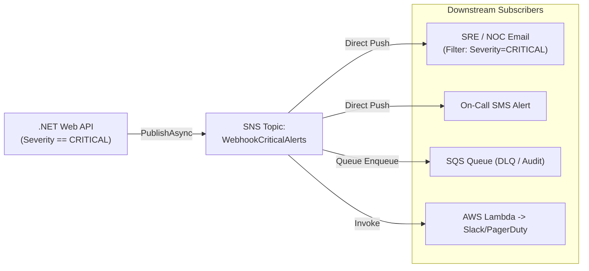
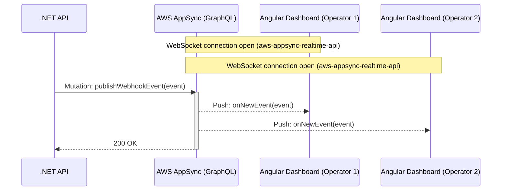

# Event-Driven Patterns (SNS & AppSync)

The architecture of **Alert Pulse** is strictly Event-Driven (EDA). Two foundational pillars comprise its asynchronous layer: **AWS SNS** for downstream multi-channel *Fan-Out* and **AWS AppSync** for reactive real-time WebSocket broadcasting.

---

## 📢 1. Fan-Out Pattern with AWS SNS

The **Fan-Out** pattern allows a single message published by the .NET API to be replicated concurrently across diverse downstream services and alert channels in a fully decoupled fashion.



### Why use SNS instead of direct email/webhook dispatching?
1. **Temporal & Functional Decoupling:** The API does not need to maintain caller phone numbers, SMTP configurations, or third-party webhooks. If an external service is temporarily unreachable, SNS manages automated retry policies with exponential backoff without stalling API ingestion.
2. **Message Filter Policies:** Mitigates alert fatigue. The topic receives all critical alerts, but individual subscriptions can attach declarative JSON filter policies:

```json
{
  "Severity": ["CRITICAL"]
}
```

3. **Guaranteed Delivery:** SNS provides robust retry handling and dead-letter queues (DLQs) to prevent lost incident alerts.

---

## ⚡ 2. Real-Time Telemetry with AWS AppSync (GraphQL)

Unlike traditional architectures that rely on periodic client-side polling, Alert Pulse leverages native **GraphQL Subscriptions** provided by AWS AppSync over WebSockets.



### How It Works:
1. **WebSocket Handshake:** On startup, the Angular service connects to the AppSync real-time endpoint via the `aws-appsync-realtime-api` protocol using API Key or Cognito authentication.
2. **Declarative Subscription:** The client issues `subscription OnNewEvent { ... }`. AppSync registers and maintains this subscription across AWS managed infrastructure.
3. **Mutation Trigger:** When the .NET API ingests a webhook, it issues an HTTP POST invoking the `publishWebhookEvent` mutation.
4. **Instant Broadcasting:** AppSync validates the mutation output and pushes the payload immediately to all connected subscribers with latency typically under 50ms.

---

## 📊 Comparison of UI Update Strategies

| Metric | HTTP Polling (3s Interval) | Self-Hosted WebSocket (SignalR/Socket.io) | AWS AppSync Subscriptions |
| :--- | :--- | :--- | :--- |
| **Alert Latency** | Average 1.5s – 3.0s | < 50ms | **< 50ms** |
| **Network Bandwidth** | High (constant empty checks) | Low | **Minimal (deltas only)** |
| **Server Cost** | Scales linearly with client count | Requires dedicated persistent servers | **Serverless (pay-per-mutation/connection)** |
| **Connection Handling**| Stateless | Complex (Redis backplane, sticky sessions) | **100% AWS Managed** |
| **Typed Contracts** | No (arbitrary JSON) | No | **Yes (Strictly Typed GraphQL SDL)** |

---

## 🔗 Related Notes
* Review full GraphQL definitions in [[Schema|GraphQL Schema]].
* See backend dispatch implementation in [[Service-Implementations|C# Service Implementations]].
* Explore the Angular WebSocket client in [[Realtime-Subscriptions|WebSocket Subscriptions]].
