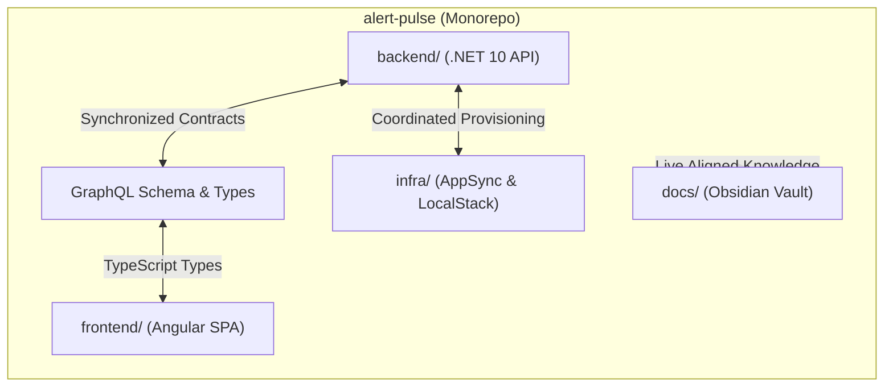

# Monorepo Structure & Strategy

**Alert Pulse** is architected as a **Monorepo** (*single repository*). All core building blocks — the .NET 10 ingestion API, the Angular 22 SPA dashboard, Infrastructure modules (AppSync & LocalStack), and the technical knowledge base (Obsidian Vault) — reside within a single, unified Git repository.

---

## 🗂️ Monorepo Directory Tree

```text
alert-pulse/                               # Monorepo Root
├── backend/                               # Backend Solution (.NET 10)
│   ├── Dockerfile                         # Multi-stage production container build
│   ├── src/
│   │   └── WebhookMonitor/                # Minimal APIs, Ingestion, HMAC, SNS, DynamoDB
│   │       ├── WebhookMonitor.csproj
│   │       ├── Program.cs
│   │       └── appsettings.json
│   └── tests/
│       └── WebhookMonitor.Tests/          # Unit & Integration Tests (xUnit)
│   └── WebhookMonitor.sln
│
├── frontend/                              # Frontend Application (Angular 22)
│   ├── Dockerfile                         # Multi-stage production container build (Node 22 + Nginx)
│   ├── nginx.conf                         # Nginx production reverse proxy & pushState routing
│   ├── src/
│   │   ├── app/                           # Standalone Components, Signals, AppSync WS
│   │   └── index.html
│   ├── angular.json
│   ├── tsconfig.json
│   └── package.json
│
├── infra/                                 # Infrastructure & Local Environment
│   ├── appsync/                           # AppSync GraphQL Schema & VTL Resolvers
│   │   ├── schema.graphql
│   │   ├── resolvers/
│   │   └── deploy-appsync.sh
│   └── init-aws.sh                        # LocalStack Bootstrap Script
│
├── docker-compose.yml                     # Local Dev Stack (LocalStack, DynamoDB Admin, Mailpit)
├── alert-pulse-vault/ (or docs/)          # Obsidian Vault (Central Technical Documentation)
│   ├── 00 - Home.md                       # Map of Content (MOC)
│   ├── Architecture/                      # Architecture Diagrams & Decision Records
│   ├── Backend/                           # C# Guides & Implementations
│   ├── Frontend/                          # TypeScript Services & Components
│   ├── Data/                              # DynamoDB Modeling & Access Patterns
│   ├── GraphQL/                           # SDL Schemas & Resolver Docs
│   ├── Infrastructure/                    # Cloud & Docker Guides (AWS Console, LocalStack)
│   ├── Runbooks/                          # Local Setup & Incident Response SOPs
│   └── Templates/                         # Blameless Post-Mortem Templates
│
├── .github/                               # CI/CD Workflows
│   └── workflows/
│       ├── backend-ci.yml                 # .NET API Build, Unit Tests & ECR Publish
│       └── frontend-ci.yml                # Angular Lint, Test & S3/CloudFront Sync
│
├── package.json                           # Root Workspace Orchestration Scripts
└── README.md                              # Repository Overview
```

---

## 🎯 Why a Monorepo for Alert Pulse?

Adopting a monorepo architecture over multiple decoupled repositories (*polyrepo*) was guided by key engineering benefits:



### 1. Atomic Contract Synchronization (Zero Schema Drift)
* When the **AppSync GraphQL Schema** (`schema.graphql`) or .NET backend DTOs evolve, the corresponding TypeScript interfaces in Angular and database mappings are updated within the **exact same Pull Request** and commit.
* This eliminates broken deployments caused by frontend code depending on API endpoints that have not yet landed from a separate repository.

### 2. Unified Developer Experience (DX)
* Cloning the repository grants immediate access to the full operating stack.
* Centralized root scripts allow running LocalStack, the .NET backend, and the Angular dashboard concurrently with a single command.

### 3. Path-Filtered CI/CD Pipelines
* GitHub Actions leverage path filtering:
  * Changes in `backend/**` trigger `dotnet test` and container compilation.
  * Changes in `frontend/**` trigger Angular linting, unit test execution, and production build artifact verification.
* Cross-cutting pull requests run end-to-end integration tests across all components simultaneously.

### 4. Docs-as-Code
* All technical documentation lives in `alert-pulse-vault/` (or `docs/`).
* Architectural decisions, runbooks, and configuration adjustments are versioned alongside code, keeping the vault permanently in sync with the codebase.

---

## 🛠️ Root Orchestration Scripts

In the root `package.json`, unified commands simplify the local workflow:

```json
{
  "name": "alert-pulse-monorepo",
  "version": "1.0.0",
  "private": true,
  "scripts": {
    "infra:up": "docker compose up -d",
    "infra:down": "docker compose down",
    "backend:dev": "dotnet watch run --project backend/src/WebhookMonitor",
    "backend:test": "dotnet test backend/tests/WebhookMonitor.Tests",
    "frontend:dev": "npm --prefix frontend run start",
    "frontend:build": "npm --prefix frontend run build",
    "dev": "npm run infra:up && concurrently \"npm run backend:dev\" \"npm run frontend:dev\""
  },
  "devDependencies": {
    "concurrently": "^8.2.2"
  }
}
```

---

## 🔗 Related Notes
* High-level architectural layout: [[Overview|Architecture Overview]].
* Step-by-step onboarding: [[Local-Development|Local Development Guide]].
* Docker Compose local setup: [[LocalStack-Docker|Local Environment with Docker & LocalStack]].
