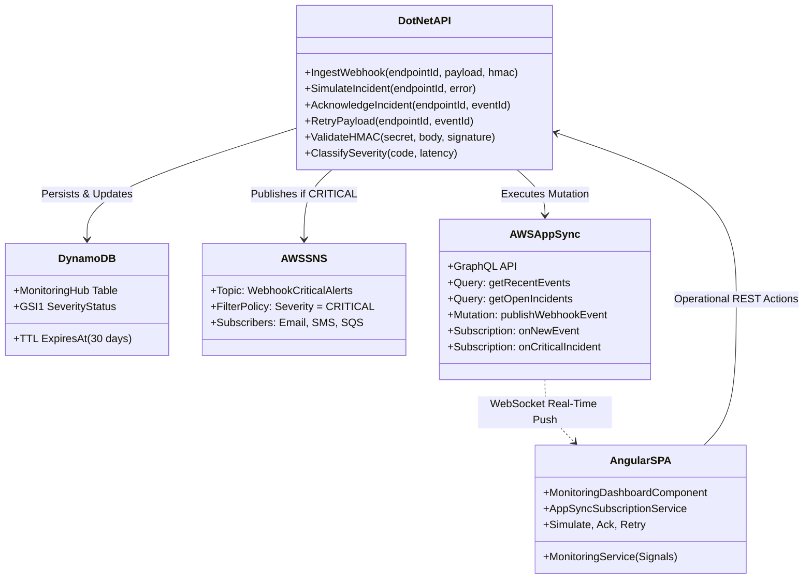

# Architecture Overview

**Alert Pulse** is an event monitoring hub and webhook ingestion platform designed to receive high-throughput traffic from external services, process critical anomalies in near real-time, persist event history into high-performance NoSQL storage, and push live telemetry to operational dashboards without relying on costly polling mechanisms.

---

## 🎯 Architectural Goals

1. **Low Ingestion Latency:** Receive incoming webhooks and acknowledge the caller with minimal delay (< 100ms), offloading heavy work asynchronously.
2. **Asynchronous Notification Decoupling:** Utilize the *Fan-Out* pattern via AWS SNS to dispatch critical notifications across multiple channels (Email, SMS, SQS, PagerDuty) without tightly coupling the API to downstream consumers.
3. **Cost-Efficient High-Performance Storage:** Implement DynamoDB *Single-Table Design* with native *Time to Live* (TTL) for automatic 30-day retention of operational logs without write/read overhead.
4. **Reactive Real-Time Telemetry:** Deliver live alerts and metrics to the Angular dashboard via **AWS AppSync GraphQL Subscriptions over WebSockets**.
5. **Operational Autonomy:** Allow SRE and NOC engineers to inspect open incidents, perform *Acknowledge* actions, and re-dispatch failed payloads (*Retry*) from a single unified UI.
6. **Unified Monorepo Architecture:** Centralize all ecosystem packages (`backend/`, `frontend/`, `infra/`, and `docs/`) in a single Git repository to guarantee atomic contract synchronization and streamlined local development. See [[Monorepo-Structure|Monorepo Structure & Strategy]].

---

## 🧩 Division of Responsibilities

### 1. .NET 10 (Web API / Ingestion & Admin)
* **HTTP Ingestion:** Receives external webhooks on high-throughput Minimal API routes.
* **Hosting Flexibility:** Runs either as a serverless **AWS Lambda** function (via API Gateway HTTP API) or as a containerized service (**AWS App Runner** / **ECS Fargate** / local Docker Compose).
* **Security:** Verifies HMAC signatures transmitted in the `X-Hub-Signature-256` header using constant-time comparison to prevent timing attacks.
* **Severity Classification:** Evaluates HTTP status codes and response latency (`LatencyMs`), classifying events into `INFO`, `WARNING`, or `CRITICAL`.
* **Persistence:** Writes events directly to DynamoDB, computing the 30-day expiration timestamp (`ExpiresAt`).
* **Critical Dispatch:** When classified as `CRITICAL`, publishes a message to the SNS alert topic with the message attribute `Severity = CRITICAL`.
* **AppSync Mutation:** Triggers a GraphQL mutation over HTTP so that AppSync pushes updates to connected WebSocket clients.
* **Operational Actions:** Exposes endpoints for incident simulation, acknowledgement, and payload replays (*retry*).

### 2. AWS SNS (Simple Notification Service)
* **Fan-Out Pattern:** Decouples the ingestion engine from alerting consumer channels.
* **Message Filtering:** Subscriptions utilize *Filter Policies* to route only `CRITICAL` severity events to NOC/SRE on-call engineers.
* **Extensibility:** New subscribers (such as AWS Lambda for Slack/PagerDuty integration or SQS dead-letter queues) can be attached without modifying backend code.

### 3. AWS DynamoDB
* **Single-Table Design:** Utilizes a single table named `MonitoringHub` with generic partition key (`PK`) and sort key (`SK`).
* **Managed Lifecycle:** The `ExpiresAt` attribute is monitored by DynamoDB's native TTL engine, automatically deleting expired event records after 30 days without consuming write units.
* **Global Secondary Index (GSI1):** Partitioned by `SeverityStatus` (e.g., `CRITICAL#OPEN`) and sorted by `CreatedAt` for instantaneous queries of unmitigated incidents without table scans.

### 4. AWS AppSync (GraphQL)
* **Data Layer & Real-Time Broadcasting:** Bridges the backend and frontend over WebSockets using the `aws-appsync-realtime-api` protocol.
* **Declarative Subscriptions:** Employs `@aws_subscribe` directives tied to the `publishWebhookEvent` mutation.
* **Zero Polling:** Completely eliminates client-side polling, saving network bandwidth and CPU cycles.

### 5. Angular (Operational Frontend)
* **Modern Reactive Architecture:** Built on Angular 22 using *Standalone Components* and *Signals* for high-frequency rendering.
* **WebSocket Connection:** Subscribes to AppSync events and updates in-memory state instantly.
* **Operational Controls:** Enables end-to-end simulation triggers, payload error inspection, incident acknowledgement, and automated request retries.

---

## 🔒 Quality Attributes & Security

| Requirement | Implementation Solution |
| :--- | :--- |
| **Origin Integrity** | HMAC SHA-256 with per-endpoint cryptographic secrets stored securely. |
| **Fault Tolerance** | Downstream failure in SNS or AppSync does not compromise guaranteed DynamoDB persistence. |
| **Timing Attack Prevention** | Hash verification performed using `CryptographicOperations.FixedTimeEquals`. |
| **Cost Optimization** | DynamoDB `PAY_PER_REQUEST` billing mode and automatic zero-cost deletion via TTL. |
| **Observability & Auditing** | Structured logging with CorrelationId tracked across the entire event lifecycle. |

---

## 🔗 Related Notes
* Review data flow sequences in [[System-Flow|System Flows & Lifecycles]].
* Understand messaging patterns in [[Event-Driven-Design|Event-Driven Patterns]].
* Check the database schema in [[DynamoDB-Design|NoSQL Data Modeling]].
* Explore repository architecture in [[Monorepo-Structure|Monorepo Structure & Strategy]].
