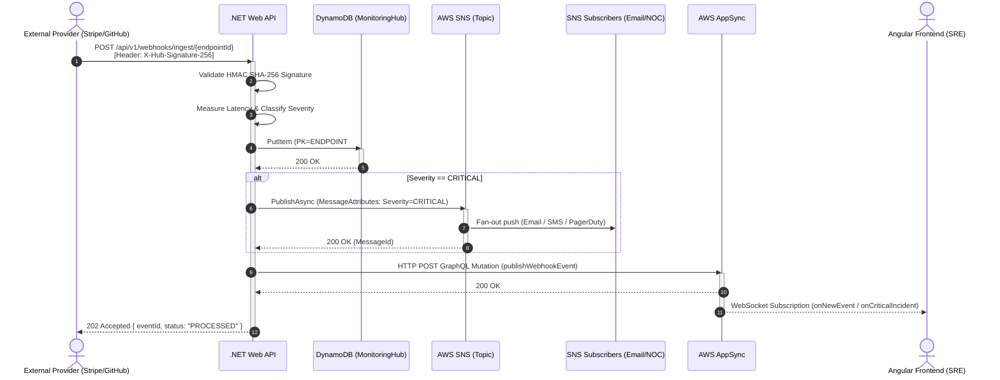
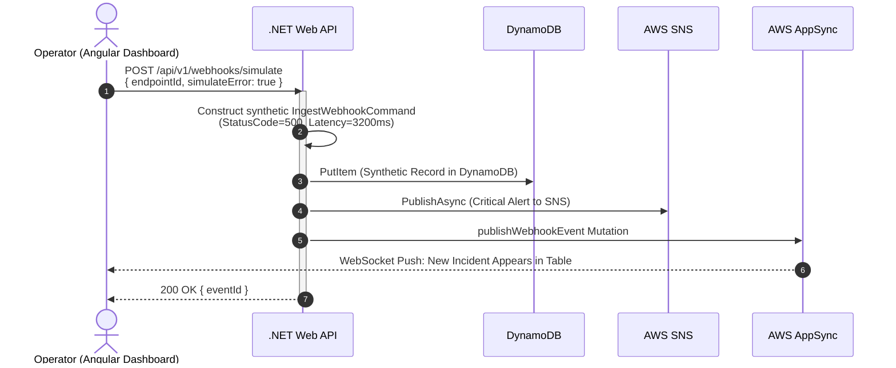
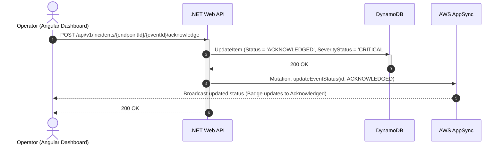
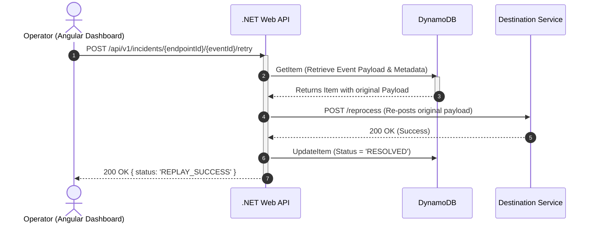

# System Flows & Lifecycles

This document details the end-to-end sequences governing the webhook ingestion lifecycle, critical alert fan-out, operational simulation, and incident mitigation workflows.

---

## 1. Primary Flow: Webhook Ingestion & Critical Alerting

### Step-by-Step Breakdown:
1. **Reception:** The external webhook provider posts a JSON payload with signature header `X-Hub-Signature-256`.
2. **Validation:** The API fetches the configured secret for the given `endpointId` and validates the HMAC using `FixedTimeEquals`. If invalid, the request is immediately rejected with `401 Unauthorized`.
3. **Classification:** If `statusCode >= 500` or `latencyMs > 5000`, the event is classified as `CRITICAL`.
4. **Guaranteed Persistence:** The record is saved in `MonitoringHub` with initial status `OPEN` and TTL attribute `ExpiresAt` (Epoch + 30 days).
5. **SNS Fan-Out:** If critical, SNS immediately broadcasts notifications across emergency alerting channels.
6. **Real-Time Push:** An AppSync GraphQL mutation triggers an instant WebSocket broadcast to connected Angular dashboards.
7. **Response:** The external caller receives a `202 Accepted` response with the unique `eventId`.

---

## 2. Operational Flow: Incident Simulation

The simulation workflow enables engineers to verify the entire alert pipeline end-to-end without waiting for external upstream outages.

---

## 3. Mitigation Flow: Incident Acknowledgement (*Acknowledge*)

When an engineer takes ownership of an active incident, they acknowledge it in the UI to notify the team and prevent alert duplicates.

---

## 4. Recovery Flow: Payload Replay (*Retry*)

When an upstream endpoint recovers from a transient outage, operators can replay stored webhook payloads directly from the dashboard:

---

## ⏱️ Latency Budget

| Pipeline Step | Target Latency (p95) | Fallback / Error Handling |
| :--- | :--- | :--- |
| HMAC Signature Validation | < 2 ms | Immediate rejection (`401 Unauthorized`) |
| DynamoDB Persistence | < 15 ms | Abort and return `500 Internal Server Error` |
| SNS Notification Publish | < 30 ms | Executed asynchronously; warning logged on failure |
| AppSync Mutation Dispatch | < 40 ms | Dispatched without blocking HTTP response to caller |
| **Total Ingestion Round-Trip** | **< 90 ms** | **Guaranteed `202 Accepted` delivered to caller** |

---

## 🔗 Related Notes
* Messaging details: [[Event-Driven-Design|Event-Driven Patterns]].
* DynamoDB key modeling: [[DynamoDB-Design|NoSQL Data Modeling]].
* REST API specifications: [[Operational-Endpoints|REST Endpoints Catalog]].
