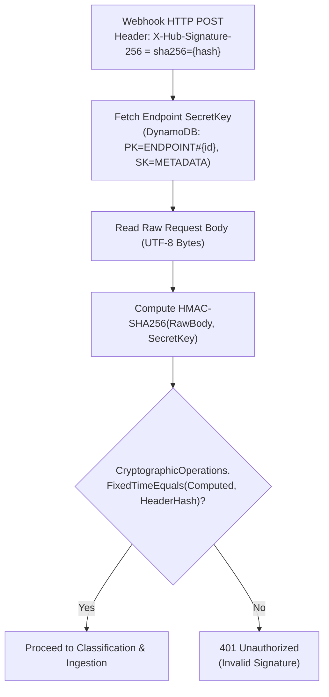
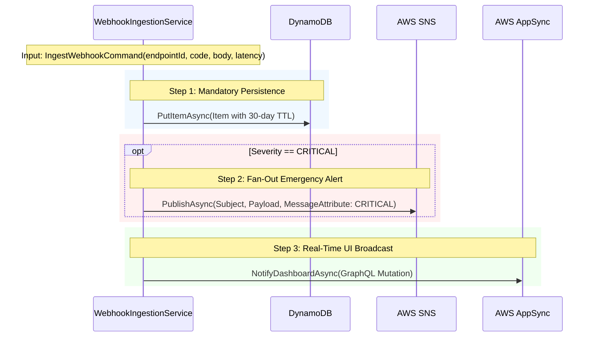

# Ingestion Pipeline & HMAC Validation

The ingestion pipeline of **Alert Pulse** is the gateway responsible for receiving webhooks, verifying cryptographic authenticity, classifying event severity, and orchestrating persistence and downstream alerting.

---

## 🔒 1. Cryptographic HMAC SHA-256 Validation

To guarantee that incoming webhooks originate legitimately from trusted providers (preventing malicious payloads or spoofing attacks), Alert Pulse implements the industry-standard HMAC SHA-256 scheme adopted by GitHub, Stripe, and Shopify via the `X-Hub-Signature-256` header.



### Mitigating Timing Attacks
> [!IMPORTANT]
> Never compare cryptographic hashes using standard string equality (`hashA == hashB`). Standard equality operators abort comparison at the first mismatched byte, allowing attackers to incrementally discover hash bytes by measuring sub-millisecond latency differentials.
> Always utilize `CryptographicOperations.FixedTimeEquals(computedBytes, headerBytes)`.

---

## ⚖️ 2. Severity Classification Logic

Incident severity is evaluated from the combined status code and measured round-trip response latency (`latencyMs`):

```csharp
public static string ClassifySeverity(int statusCode, int latencyMs)
{
    // Server errors or intolerable latency (> 5s) trigger immediate critical alerts
    if (statusCode >= 500 || latencyMs > 5000)
    {
        return "CRITICAL";
    }

    // Client errors or degraded performance (> 2s) trigger warning notices
    if (statusCode >= 400 || latencyMs > 2000)
    {
        return "WARNING";
    }

    // Healthy responses within SLA are informational
    return "INFO";
}
```

### Decision Matrix:
| Status Code | Latency (ms) | Resulting Severity | Triggered Actions |
| :---: | :---: | :---: | :--- |
| `200 - 299` | `<= 2000` | **INFO** | Save to DynamoDB + Notify AppSync |
| `200 - 299` | `> 2000` and `<= 5000` | **WARNING** | Save to DynamoDB + Notify AppSync |
| `200 - 299` | `> 5000` | **CRITICAL** | Save to DynamoDB + Notify AppSync + **Publish SNS Alert** |
| `400 - 499` | `<= 5000` | **WARNING** | Save to DynamoDB + Notify AppSync |
| `400 - 499` | `> 5000` | **CRITICAL** | Save to DynamoDB + Notify AppSync + **Publish SNS Alert** |
| `>= 500` | Any | **CRITICAL** | Save to DynamoDB + Notify AppSync + **Publish SNS Alert** |

---

## 🔄 3. Three-Step Execution Pipeline



### Fault Isolation:
* If DynamoDB persistence fails, the operation aborts and returns `500`, guaranteeing state consistency.
* If DynamoDB succeeds, downstream network failures in AppSync are caught and logged as warnings, preventing transient WebSocket hiccups from dropping valid webhooks or blocking SNS alerts.

---

## 🔗 Related Notes
* Full C# service implementation: [[Service-Implementations|C# Service Implementations]].
* REST endpoint contracts: [[Operational-Endpoints|REST Endpoints Catalog]].
