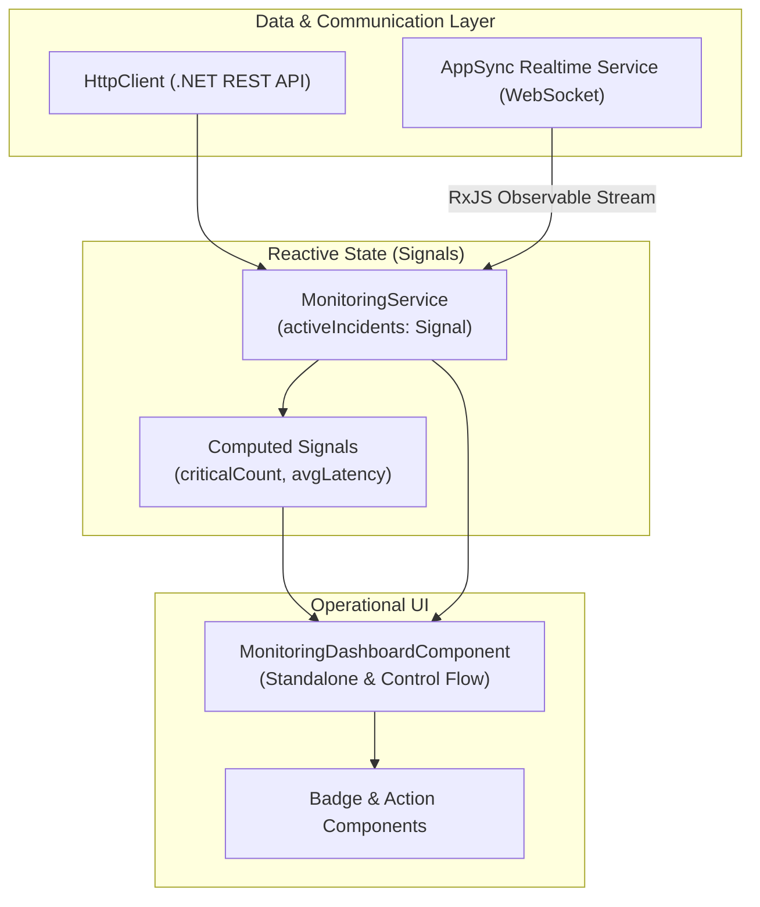

# Angular 22 Architecture & Signals

The frontend of **Alert Pulse** is an operational Single Page Application (SPA) built with **Angular 22**. Designed to render high-frequency real-time event feeds with minimal CPU overhead, it embraces modern framework capabilities.

---

## 🏛️ Architectural Pillars



### 1. Standalone Components (No NgModules)
The application relies 100% on standalone components, eliminating NgModule boilerplate and enabling aggressive tree-shaking for minimal bundle sizes.

### 2. Angular Signals for State Management
Rather than burdening the application with complex state libraries (e.g., NgRx Store) for live telemetry tables, we employ **Angular Signals**:
* `signal<WebhookEvent[]>([])`: Holds the in-memory circular buffer of received events.
* `computed()`: Dynamically calculates metrics (e.g., critical open incident count, average response latency) without unnecessary re-renders.
* `toSignal()`: Bridges RxJS WebSocket streams directly into reactive UI bindings.

### 3. Functional Dependency Injection (`inject()`)
Replaces constructor-based injection with Angular's `inject()` function, streamlining testing and composition.

### 4. Built-In Control Flow (`@if`, `@for`, `@empty`)
Adopts modern template control flow syntax, offering superior compiler performance and strict type checking over legacy structural directives (`*ngIf`, `*ngFor`).

---

## 📁 Frontend Directory Layout

```text
frontend/src/app/
├── core/
│   ├── models/
│   │   ├── webhook-event.model.ts     # WebhookEvent, Severity, Status interfaces
│   │   └── endpoint-config.model.ts  # EndpointConfig model
│   └── services/
│       ├── monitoring.service.ts      # State management (Signals) and REST client
│       └── appsync-subscription.service.ts # WebSocket & RxJS management
├── features/
│   └── dashboard/
│       ├── monitoring-dashboard.component.ts
│       ├── monitoring-dashboard.component.html
│       └── monitoring-dashboard.component.scss
├── shared/
│   └── components/
│       └── severity-badge.component.ts
├── app.config.ts                      # Global providers (provideHttpClient, etc.)
└── app.component.ts
```

---

## 🔗 Related Notes
* Central state service: [[Monitoring-Service|Telemetry & State Service]].
* WebSocket client: [[Realtime-Subscriptions|WebSocket Subscriptions]].
* Operational dashboard UI: [[Dashboard-Component|Operational Dashboard Component]].
