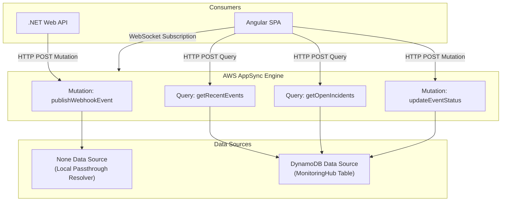

# Resolvers & Real-Time WebSockets

This document explains the internal architecture of AWS AppSync resolvers and the custom WebSocket protocol utilized to push live webhook events to the Angular operational frontend.

---

## ⚙️ Resolver Architecture

AppSync maps GraphQL fields to target **Data Sources** based on their execution context:



### 1. `publishWebhookEvent` (Local Resolver / None Data Source)
Because the .NET API already persists the record in DynamoDB before invoking AppSync, this mutation does not write to the database again. It binds to a `NONE` data source:
* **Function:** Acts as an instant pub/sub broadcaster. Validates input and echoes it directly.
* **Result:** AppSync immediately triggers connected WebSocket subscribers with sub-millisecond resolver overhead.

```json
// VTL Request Mapping Template (Local Passthrough)
{
  "version": "2018-05-29",
  "payload": $util.toJson($context.arguments.event)
}

// VTL Response Mapping Template
$util.toJson($context.result)
```

### 2. `getOpenIncidents` (DynamoDB Resolver via GSI1)
Executes an indexed search against `GSI1-Severity`:
```json
// Request Mapping Template
{
  "version": "2018-05-29",
  "operation": "Query",
  "index": "GSI1-Severity",
  "query": {
    "expression": "SeverityStatus = :sevStatus",
    "expressionValues": {
      ":sevStatus": { "S": "${context.arguments.severity}#OPEN" }
    }
  },
  "scanIndexForward": false
}
```

---

## 🔌 WebSocket Protocol: `aws-appsync-realtime-api`

AppSync implements a dedicated WebSocket sub-protocol for resilient subscription management.

### 1. Connection & Handshake
The client establishes a socket connection to the real-time endpoint (replacing `appsync-api` with `appsync-realtime-api`):
* Authentication headers (`x-api-key` or Cognito tokens) are base64-encoded in the query string or `connection_init` payload.

```json
// Client handshake message:
{
  "type": "connection_init"
}

// AppSync confirmation response:
{
  "type": "connection_ack",
  "payload": {
    "connectionTimeoutMs": 300000
  }
}
```

### 2. Registering Subscriptions (`start`)
The client sends a `start` frame containing a client-generated UUID (`id`) and the GraphQL subscription query:

```json
{
  "id": "sub-101",
  "type": "start",
  "payload": {
    "data": "{\"query\":\"subscription OnNew { onNewEvent { id endpointId statusCode latencyMs severity status errorMessage } }\"}",
    "extensions": {
      "authorization": {
        "x-api-key": "da2-xxxxxxxxxxxxxxxxxxxx",
        "host": "xxxxxxxxxxxxxx.appsync-api.us-east-1.amazonaws.com"
      }
    }
  }
}
```

### 3. Real-Time Data Push (`data`)
When the .NET API executes the mutation, AppSync broadcasts a `data` message to the subscriber:

```json
{
  "id": "sub-101",
  "type": "data",
  "payload": {
    "data": {
      "onNewEvent": {
        "id": "e89192ab4f",
        "endpointId": "stripe-billing",
        "statusCode": 500,
        "latencyMs": 4200,
        "severity": "CRITICAL",
        "status": "OPEN",
        "errorMessage": "Simulated Gateway Timeout"
      }
    }
  }
}
```

### 4. Heartbeats / Keep-Alive (`ka`)
AppSync sends `{ "type": "ka" }` frames every 20-30 seconds to maintain connection health through NAT gateways and load balancers.

---

## 🛡️ Connection Resilience

* **Exponential Backoff:** If disconnected due to network instability, the Angular service attempts automated reconnects (1s, 2s, 4s, capped at 30s).
* **State Reconciliation:** Upon reconnection, the client can issue a `getOpenIncidents` query to catch any incidents that occurred during the offline window.

---

## 🔗 Related Notes
* Schema definitions: [[Schema|GraphQL Schema]].
* Frontend Angular implementation: [[Realtime-Subscriptions|WebSocket Subscriptions]].
