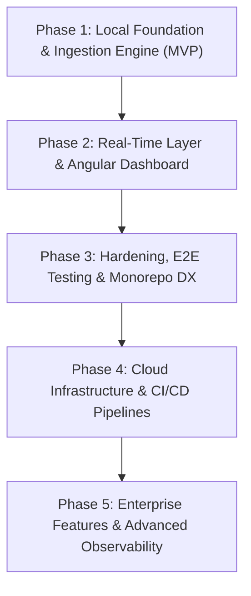

# Alert Pulse: Development Roadmap

This document outlines the engineering roadmap for **Alert Pulse**, breaking down delivery into progressive phases from local MVP foundation to production-grade cloud deployment and enterprise enhancements.

---

## 🗺️ High-Level Phase Overview

---

## 📅 Roadmap Matrix

| Phase | Focus Area | Target Milestone | Status | Key Deliverables |
| :---: | :--- | :--- | :---: | :--- |
| **Phase 1** | Backend & Local Infra | Core Ingestion & Storage | 🟢 *Completed* | LocalStack, .NET 10 API, HMAC SHA-256, DynamoDB, SNS |
| **Phase 2** | Real-Time & Frontend | Reactive Monitoring Hub | 🟢 *Completed* | AppSync WebSockets, Angular 22 Signals, Live UI |
| **Phase 3** | Integration & DX | Monorepo Orchestration | 🟢 *Completed* | Root scripts, Polly retries, containerized dev stack, E2E test suite |
| **Phase 4** | DevOps & Cloud | Production Deployment | 🟢 *Completed* | AWS Console Runbook, GitHub Actions, AWS ECS/S3/CloudFront |
| **Phase 5** | Enterprise & Ops | Observability & Security | ⚪ *Planned* | Cognito RBAC, Slack/PagerDuty bot, OpenTelemetry |

---

## 🚀 Phase 1: Local Foundation & Ingestion Engine (MVP)

> **Objective:** Deliver a self-contained local backend capable of securely receiving webhooks, validating cryptographic signatures, persisting to DynamoDB with TTL, and publishing critical alerts to SNS.

### Milestone 1.1: Local Support Environment
- [x] Configure root [`docker-compose.yml`](file:///Users/gcorrea/Documents/projetos/alert-pulse/docker-compose.yml) with LocalStack, DynamoDB Admin, Mailpit, and Webhook Sink.
- [x] Create automated bootstrap script [`infra/init-aws.sh`](file:///Users/gcorrea/Documents/projetos/alert-pulse/infra/init-aws.sh) to provision `MonitoringHub` table, GSI1 index, TTL, SNS topic, and SQS queue.
- [x] Document local development runbook and architecture in [[Local-Development|Local Development Guide]].

### Milestone 1.2: .NET 10 Backend API Skeleton
- [x] Scaffold `backend/src/WebhookMonitor` Minimal API project (.NET 10).
- [x] Configure `appsettings.json` and AWS SDK options to support both LocalStack (`ServiceURL`) and AWS Cloud.
- [x] Register core AWS SDK clients (`IAmazonDynamoDB`, `IAmazonSimpleNotificationService`).
- [x] Add structured logging with Serilog and correlation ID tracking (`CorrelationIdMiddleware`).
- [x] Add health check endpoints (`/health/live`, `/health/ready`).

### Milestone 1.3: Cryptographic Validation & Ingestion Pipeline
- [x] Implement `IHmacValidationService` using `HMACSHA256` and `CryptographicOperations.FixedTimeEquals` to prevent timing attacks.
- [x] Implement severity classification engine (`ClassifySeverity` with HTTP status code and latency rules).
- [x] Implement `WebhookIngestionService`:
  - DynamoDB `PutItem` with 30-day TTL (`ExpiresAt`).
  - SNS `PublishAsync` with `Severity = CRITICAL` message attribute.
  - Ingestion Minimal API endpoint: `POST /api/v1/webhooks/ingest/{endpointId}`.

### Milestone 1.4: Operational Endpoints & Local Testing
- [x] Implement `POST /api/v1/webhooks/simulate` for synthetic testing.
- [x] Implement `POST /api/v1/incidents/{endpointId}/{eventId}/acknowledge`.
- [x] Implement `POST /api/v1/incidents/{endpointId}/{eventId}/retry`.
- [x] Implement Endpoint CRUD endpoints (`GET /api/v1/endpoints`, `POST /api/v1/endpoints`).
- [x] Build unit test suite in `backend/tests/WebhookMonitor.Tests` (HMAC validation tests, severity decision matrix tests).
- [x] Write integration test against LocalStack DynamoDB & SNS.

---

## ⚡ Phase 2: Real-Time Layer & Angular Dashboard

> **Objective:** Establish real-time push streaming via AWS AppSync WebSockets and provide an operational dark-mode dashboard built with Angular Signals.

### Milestone 2.1: AppSync GraphQL Integration
- [x] Deploy GraphQL schema ([`schema.graphql`](file:///Users/gcorrea/Documents/projetos/alert-pulse/infra/appsync/schema.graphql)) to AppSync.
- [x] Configure `NoneDataSource` and request/response mapping templates for `publishWebhookEvent`.
- [x] Configure DynamoDB Data Source for `getOpenIncidents` querying `GSI1-Severity`.
- [x] Implement `HttpAppSyncNotifier` in .NET API to dispatch mutations upon webhook ingestion.

### Milestone 2.2: Angular 22 Project Bootstrap
- [x] Scaffold `frontend/` project using Angular 22 with Standalone Components and zero NgModules.
- [x] Configure SCSS styling for NOC/SRE operational dark theme (Tailwind or custom CSS).
- [x] Implement domain models (`WebhookEvent`, `SeverityLevel`, `IncidentStatus`).

### Milestone 2.3: Reactive State & Telemetry Service
- [x] Implement `MonitoringService` leveraging Angular Signals:
  - Circular buffer `signal<WebhookEvent[]>` capped at 50 items.
  - Computed metrics: `criticalCount`, `openCount`, `averageLatency`.
  - HTTP client methods for `/simulate`, `/acknowledge`, and `/retry`.
- [x] Implement `AppSyncSubscriptionService`:
  - Native RxJS WebSocket connection (`aws-appsync-realtime-api` protocol).
  - Exponential backoff reconnection strategy.
  - Connection status signal (`isConnected`).

### Milestone 2.4: Dashboard UI & Operational Actions
- [x] Build `MonitoringDashboardComponent` with modern control flow (`@for`, `@if`, `@empty`).
- [x] Render metrics topbar with live counters and WebSocket health indicator.
- [x] Render live incident stream table with color-coded severity badges (`CRITICAL`, `WARNING`, `INFO`).
- [x] Add interactive buttons: "Simulate OK", "Simulate Critical", "Acknowledge", and "Retry".

---

## 🛡️ Phase 3: Hardening, E2E Testing & Monorepo DX

> **Objective:** Integrate the full monorepo developer workflow, add resilience policies, and automate end-to-end regression testing.

### Milestone 3.1: Monorepo Orchestration
- [x] Create root `package.json` with `concurrently` scripts:
  - `npm run infra:up`
  - `npm run dev` (starts LocalStack, .NET API, and Angular concurrently).
  - `npm run test:all` (runs backend xUnit and frontend Jasmine/Jest tests).

### Milestone 3.2: Resilience & Fault Tolerance
- [x] Integrate Polly retry policies with exponential backoff for outbound webhook replay calls.
- [x] Add ASP.NET Core rate limiting to protect ingestion routes against DDoS bursts.
- [x] Configure Dead-Letter Queue (DLQ) redrive mechanisms for unprocessable SNS/SQS messages.

### Milestone 3.3: Automated End-to-End Test Suite
- [x] Implement automated Bash/Python E2E test script (`npm run test:all` and test suites):
  - Triggers `/simulate`.
  - Asserts DynamoDB write in LocalStack.
  - Asserts SNS message receipt in SQS `critical-alerts-queue`.
  - Asserts real-time delivery to client stream.
- [x] Automated test suites for backend (.NET xUnit) and frontend (Karma / Headless Chrome).

---

## ☁️ Phase 4: Cloud Infrastructure & CI/CD Pipelines

> **Objective:** Configure production AWS cloud infrastructure via AWS Console and configure continuous integration and continuous deployment pipelines.

### Milestone 4.1: Cloud Infrastructure Runbook (AWS Console)
- [x] Document step-by-step AWS Console provisioning procedures in [[AWS-Console|AWS Console Setup & Resource Runbook]]:
  - DynamoDB `MonitoringHub` table, `GSI1-Severity` index, and TTL on `ExpiresAt`.
  - SNS `WebhookCriticalAlerts` topic, email & SQS subscribers with critical filter policies.
  - SQS `critical-alerts-dlq` and redrive policy on `critical-alerts-queue`.
  - AppSync `AlertPulseApi`, `schema.graphql`, `NoneDataSource`, and DynamoDB data sources.
  - IAM least-privilege execution roles for .NET API and AppSync DynamoDB access.

### Milestone 4.2: CI/CD Workflows (GitHub Actions)
- [x] `.github/workflows/backend-ci.yml`: Path-filtered lint, build, test, and Docker image publishing to Amazon ECR.
- [x] `.github/workflows/frontend-ci.yml`: Path-filtered lint, unit tests, and production build artifact upload to AWS S3 with CloudFront CDN cache invalidation.
- [x] Deploy targets:
  - .NET API deployed to AWS ECS/Fargate or AWS App Runner.
  - Angular SPA deployed to AWS S3 bucket with CloudFront CDN distribution.

---

## 🏢 Phase 5: Enterprise Features & Observability

> **Objective:** Expand the platform with enterprise-grade security, multi-tenancy, and advanced operational observability.

### Milestone 5.1: Authentication & RBAC
- [ ] Integrate Amazon Cognito User Pools for operator dashboard login.
- [ ] Implement role-based access control (Admin, Operator, Viewer).
- [ ] Replace static API keys with Cognito JWT authorization on AppSync subscriptions.

### Milestone 5.2: Multi-Tenancy & Custom Rules
- [ ] Add per-endpoint configurable severity thresholds (custom latency SLA per client).
- [ ] Implement webhook payload transformations before dispatching to destination services.
- [ ] Add IP whitelisting per endpoint.

### Milestone 5.3: Observability & Incident Integrations
- [ ] Export OpenTelemetry traces and metrics from .NET API to AWS CloudWatch / Datadog.
- [ ] Implement interactive Slack / PagerDuty bot (Acknowledge and Retry directly from Slack channels).
- [ ] Build historical analytics views (uptime percentage, failure rate trends, p99 latency graphs).

---

## 🔗 Related Notes
* System architecture: [[Overview|Architecture Overview]].
* Monorepo layout: [[Monorepo-Structure|Monorepo Structure & Strategy]].
* Local developer environment: [[LocalStack-Docker|Local Environment with Docker & LocalStack]].
* Operational runbook: [[Incident-Response|Incident Response Procedures]].
