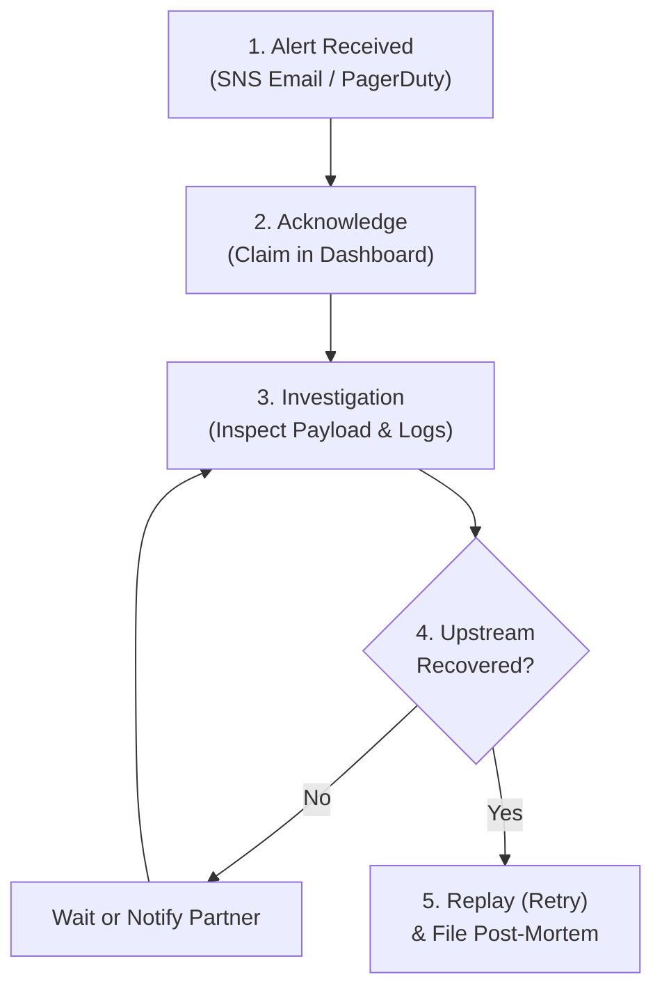

# Incident Response Procedures (NOC/SRE Runbook)

This runbook defines standard operating procedures (SOP) for Site Reliability Engineers (SRE) and Network Operations Center (NOC) responders when `CRITICAL` or `WARNING` alerts are triggered by **Alert Pulse**.

---

## 🚨 Severity Levels & SLAs

| Severity | Trigger Condition | Notification Channel | Response SLA | Immediate Action |
| :---: | :--- | :--- | :---: | :--- |
| **CRITICAL** | `StatusCode >= 500` OR `LatencyMs > 5000` | SNS -> PagerDuty / SMS / Email | **15 minutes** | Immediate Acknowledge + Investigation |
| **WARNING** | `StatusCode >= 400` OR `LatencyMs > 2000` | Angular Dashboard / Daily Summary | **2 hours** | Inspect payload integrity & schema drift |
| **INFO** | Normal operation (`200 OK`, `< 2000ms`) | Dashboard (History) | N/A | Passive monitoring |

---

## 🔄 Five-Phase Incident Response Workflow



---

### Phase 1: Alert Detection & Notification
The on-call engineer receives an automated alert message:
```text
Subject: [CRITICAL ALERT] Webhook Failure on stripe-billing
Body: {"EventId":"d4f2910a3c","EndpointId":"stripe-billing","StatusCode":500,"LatencyMs":4200,"ErrorMessage":"Gateway Timeout"}
```

### Phase 2: Incident Acknowledgement (*Acknowledge*)
1. Navigate to the **Alert Pulse Dashboard** (`https://monitor.internal` or `http://localhost:4200`).
2. Locate the row matching the incoming `EventId`.
3. Click **"Acknowledge"**.
   * *Purpose:* Updates DynamoDB status to `ACKNOWLEDGED`, removes the item from the open critical queue, and signals to teammates that an engineer owns the incident.

### Phase 3: Investigation & Diagnosis
1. **Analyze Error Category:**
   * If `StatusCode == 500` with *Timeout*: Verify health of internal receiving services or database connection pools.
   * If `StatusCode == 400` or `422`: Check whether external provider updated their payload schema without notice.
2. **Retrieve Full Payload from DynamoDB:**
   ```bash
   aws dynamodb get-item \
       --table-name MonitoringHub \
       --key '{"PK": {"S": "ENDPOINT#stripe-billing"}, "SK": {"S": "EVENT#1791724286000#d4f2910a3c"}}' \
       --query "Item.Payload.S" \
       --output text | jq .
   ```

### Phase 4: Mitigation & Payload Replay (*Retry*)
Once the upstream dependency or internal service is restored:
1. In the dashboard, click **"Retry"** adjacent to the incident.
2. The .NET API retrieves the stored payload and re-posts it to the destination service.
3. Upon receiving a `200 OK` confirmation, the incident is marked as `RESOLVED`.

### Phase 5: Post-Incident Review
For high-impact production outages, document findings and preventive actions using the [[Incident-Postmortem|Incident Post-Mortem Template]].

---

## 🔗 Related Notes
* Retry and Acknowledge endpoints: [[Operational-Endpoints|REST Endpoints Catalog]].
* Post-mortem template: [[Incident-Postmortem|Incident Post-Mortem Template]].
