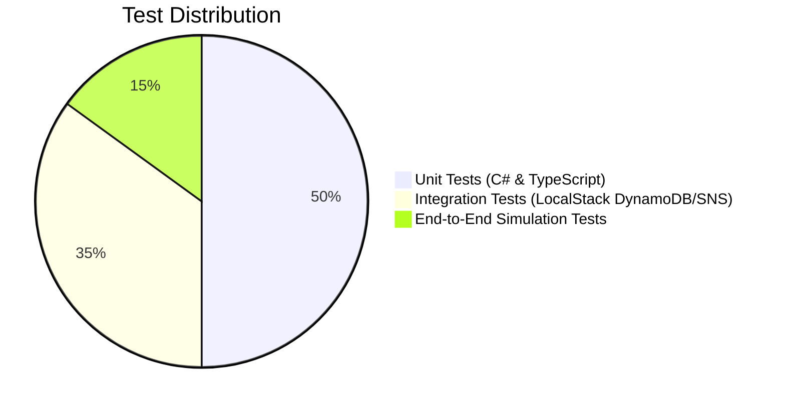

# Testing Strategy (Unit to E2E)

An incident monitoring and dispatch hub demands exceptional reliability. A failure within the monitoring engine creates dangerous operational blind spots. The testing strategy of **Alert Pulse** spans multiple tiers of the test pyramid.

---

## 🔺 Testing Pyramid Distribution



---

## 1. Unit Tests (.NET 10 & xUnit)

Unit tests validate isolated security and business logic rules:

### Cryptographic HMAC SHA-256 Validation
```csharp
public class HmacValidationServiceTests
{
    private readonly HmacValidationService _sut = new();
    private const string Secret = "whsec_test_secret_123";

    [Fact]
    public void IsValidSignature_ValidHash_ReturnsTrue()
    {
        var body = Encoding.UTF8.GetBytes("{\"test\":true}");
        using var hmac = new HMACSHA256(Encoding.UTF8.GetBytes(Secret));
        var hash = Convert.ToHexString(hmac.ComputeHash(body)).ToLowerInvariant();

        var result = _sut.IsValidSignature(body, $"sha256={hash}", Secret);

        Assert.True(result);
    }

    [Fact]
    public void IsValidSignature_TamperedBody_ReturnsFalse()
    {
        var originalBody = Encoding.UTF8.GetBytes("{\"amount\":100}");
        var tamperedBody = Encoding.UTF8.GetBytes("{\"amount\":9999}");
        using var hmac = new HMACSHA256(Encoding.UTF8.GetBytes(Secret));
        var hash = Convert.ToHexString(hmac.ComputeHash(originalBody)).ToLowerInvariant();

        var result = _sut.IsValidSignature(tamperedBody, $"sha256={hash}", Secret);

        Assert.False(result);
    }
}
```

### Severity Decision Matrix Tests
```csharp
[Theory]
[InlineData(200, 150, "INFO")]
[InlineData(200, 2500, "WARNING")]
[InlineData(200, 5200, "CRITICAL")]
[InlineData(404, 100, "WARNING")]
[InlineData(500, 100, "CRITICAL")]
[InlineData(503, 7000, "CRITICAL")]
public void ClassifySeverity_Scenarios_MatchesExpected(int code, int latency, string expected)
{
    var severity = WebhookIngestionService.ClassifySeverity(code, latency);
    Assert.Equal(expected, severity);
}
```

---

## 2. Integration Tests with LocalStack

Verify authentic interaction against the AWS SDK using LocalStack:

```csharp
public class DynamoDbIntegrationTests : IAsyncLifetime
{
    private readonly AmazonDynamoDBClient _client = new(new AmazonDynamoDBConfig
    {
        ServiceURL = "http://localhost:4566",
        AuthenticationRegion = "us-east-1"
    });

    [Fact]
    public async Task PutItem_And_QueryGSI1_Succeeds()
    {
        // 1. Persist record
        var eventId = Guid.NewGuid().ToString("N");
        await _client.PutItemAsync(new PutItemRequest
        {
            TableName = "MonitoringHub",
            Item = new Dictionary<string, AttributeValue>
            {
                ["PK"] = new("ENDPOINT#test-integration"),
                ["SK"] = new($"EVENT#{DateTimeOffset.UtcNow.ToUnixTimeMilliseconds()}#{eventId}"),
                ["Id"] = new(eventId),
                ["SeverityStatus"] = new("CRITICAL#OPEN"),
                ["CreatedAt"] = new(DateTimeOffset.UtcNow.ToString("o"))
            }
        });

        // 2. Query against GSI1-Severity
        var query = await _client.QueryAsync(new QueryRequest
        {
            TableName = "MonitoringHub",
            IndexName = "GSI1-Severity",
            KeyConditionExpression = "SeverityStatus = :s",
            ExpressionAttributeValues = new Dictionary<string, AttributeValue>
            {
                [":s"] = new("CRITICAL#OPEN")
            }
        });

        Assert.Contains(query.Items, item => item["Id"].S == eventId);
    }

    public Task InitializeAsync() => Task.CompletedTask;
    public Task DisposeAsync() => Task.CompletedTask;
}
```

---

## 3. End-to-End Simulation Tests (Automated CI/CD Script)

Bash test script executed during CI pipelines to validate the integrated ecosystem:

```bash
#!/usr/bin/env bash
set -e

echo "1. Triggering critical simulation on .NET API..."
SIMULATION_RES=$(curl -s -X POST http://localhost:5000/api/v1/webhooks/simulate \
  -H "Content-Type: application/json" \
  -d '{"endpointId":"stripe-billing","statusCode":500,"latencyMs":3500,"payload":"{\"event\":\"ci-test\"}","errorMessage":"CI Error"}')

EVENT_ID=$(echo "$SIMULATION_RES" | jq -r '.eventId')
echo "Synthetic event generated with ID: $EVENT_ID"

echo "2. Validating persistence in DynamoDB (LocalStack)..."
SAVED_ITEM=$(aws --endpoint-url=http://localhost:4566 dynamodb query \
  --table-name MonitoringHub \
  --index-name GSI1-Severity \
  --key-condition-expression "SeverityStatus = :s" \
  --expression-attribute-values '{":s":{"S":"CRITICAL#OPEN"}}' \
  --query "Items[?Id.S=='$EVENT_ID'] | [0]" \
  --output json)

if [ "$SAVED_ITEM" != "null" ]; then
  echo "✅ Success: Event found in GSI1-Severity!"
else
  echo "❌ Failure: Event was not persisted in DynamoDB."
  exit 1
fi
```

---

## 🔗 Related Notes
* Running LocalStack locally: [[LocalStack-Docker|Local Environment with Docker & LocalStack]].
* Browser simulation UI: [[Dashboard-Component|Operational Dashboard Component]].
